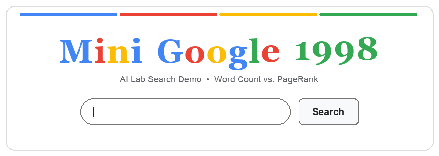
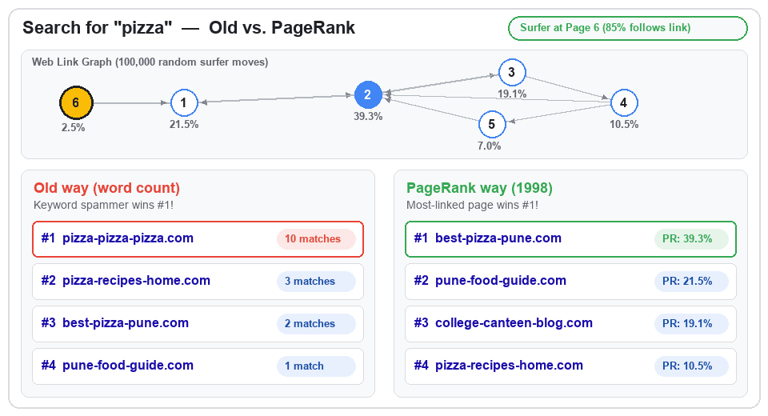
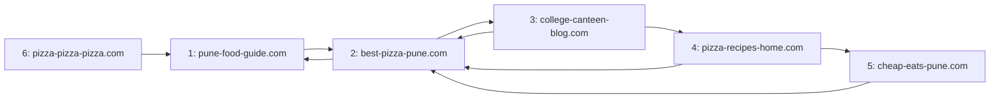

  
  
  
  

**A first-year AI lab search engine showing why 1998 Google PageRank beat keyword stuffing.**

---

## Old Way vs. PageRank Way

Search for **`pizza`** and watch two ranking algorithms compete side by side:

  

- **Left — Old way (Word Count):** Ranks pages strictly by how many times the search word appears in the text. A spammy page repeating `"pizza"` 10 times (`pizza-pizza-pizza.com`) steals **#1** even though nobody links to it.
- **Right — PageRank way (1998):** Simulates a **random surfer** taking **100,000 moves** across the web graph. Because trusted pages link to `best-pizza-pune.com`, it earns the highest PageRank (**~39%**) and wins **#1**.

---

## How the Random Surfer Works

1. Start on a **random page** among the 6 pages.
2. Repeat **100,000 times**:
   - **15% chance:** The surfer gets bored and jumps to any random page.
   - **85% chance:** The surfer follows one of the current page's outgoing links at random.
   - Record a visit to whichever page the surfer lands on.
3. Compute each page's score:

$$\text{PageRank (\%)} = \frac{\text{Visits}}{\text{100,000}} \times 100$$

---

## Dataset & Link Graph

| Page | URL | Text | Links To |
| :---: | :--- | :--- | :---: |
| **1** | `pune-food-guide.com` | Where to eat in Pune - vada pav and biryani and pizza | `2` |
| **2** | `best-pizza-pune.com` | Fresh wood-fired pizza made daily - try our cheese pizza | `1, 3` |
| **3** | `college-canteen-blog.com` | Student reviews of canteen food and chai and Friday pizza | `2, 4` |
| **4** | `pizza-recipes-home.com` | Make pizza at home - pizza dough and pizza sauce | `2, 5` |
| **5** | `cheap-eats-pune.com` | Good food under 100 rupees - misal and dosa and pizza slices | `2` |
| **6** | `pizza-pizza-pizza.com` | pizza pizza pizza pizza pizza pizza pizza pizza pizza pizza | `1` |

---

## How to Run

No installs, no build step, and no server required:

1. Download or clone this repository.
2. Double-click **`index.html`** to open it in any web browser.
3. Type a word like `pizza`, `pune`, `food`, or `chai` and click **Search**!
